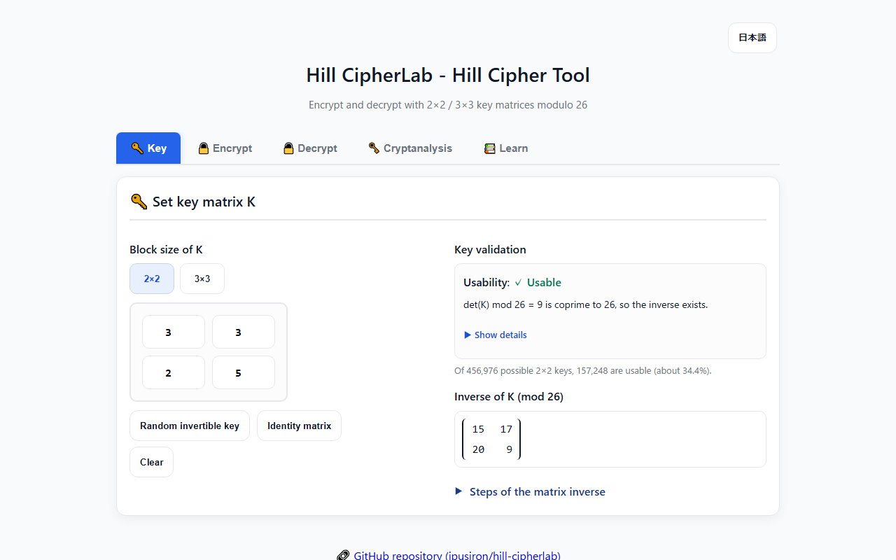
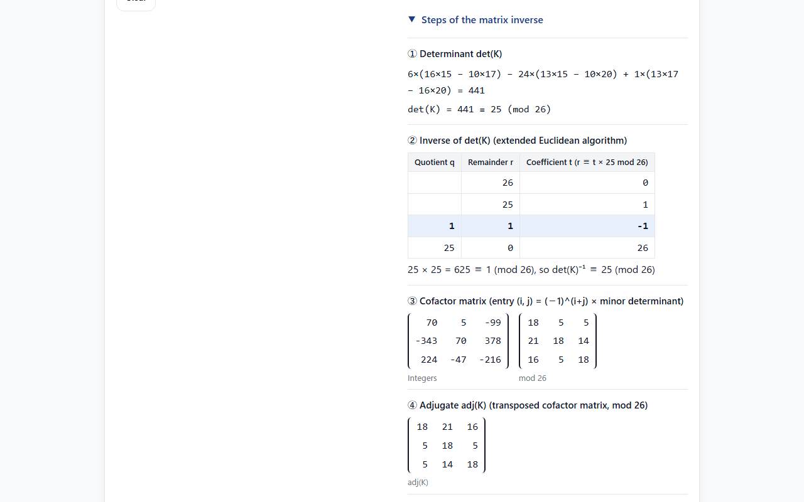
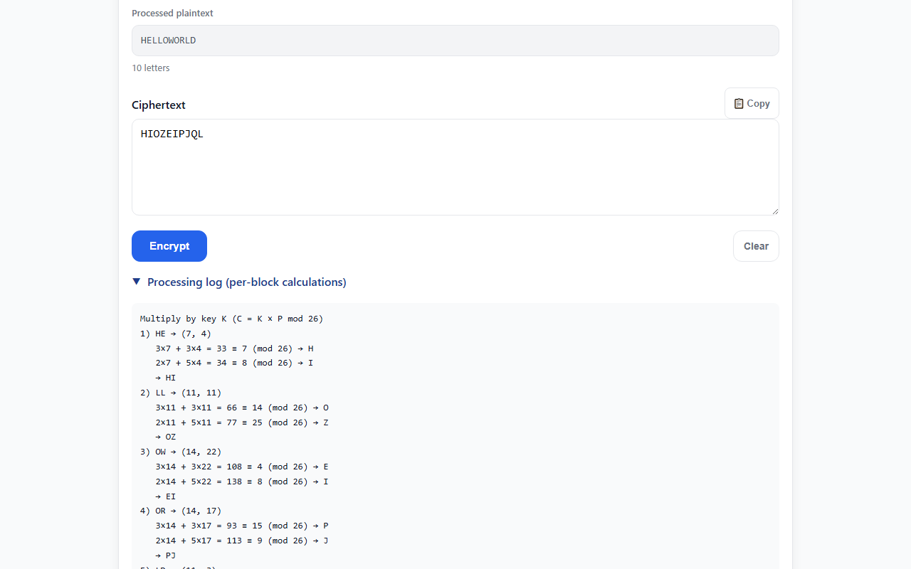
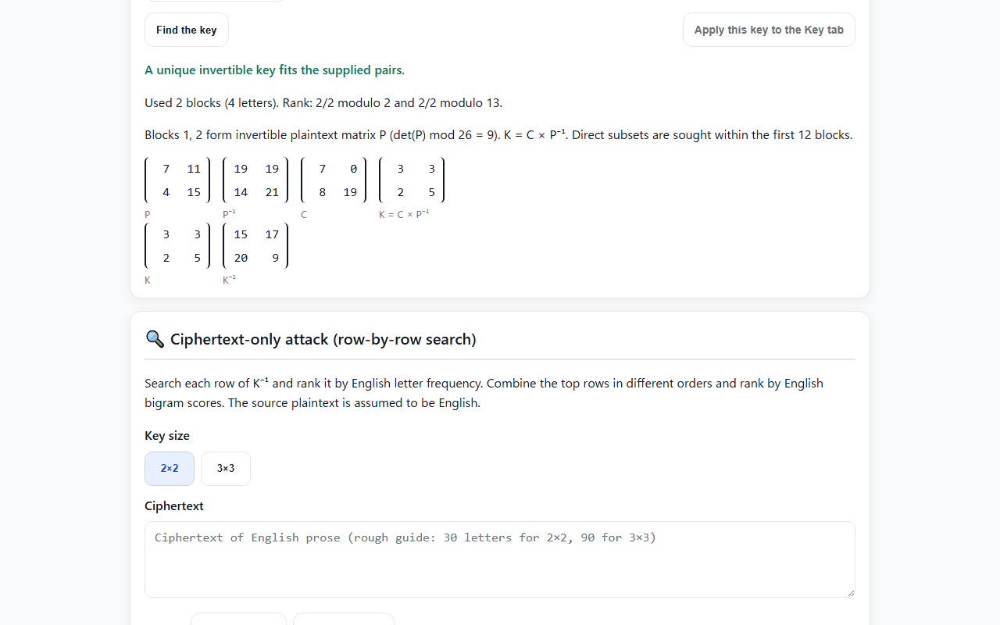

<!--
---
id: day093
slug: hill-cipherlab

title: "Hill CipherLab"

subtitle_ja: "ヒル暗号ツール"
subtitle_en: "Hill Cipher Educational Tool"

description_ja: "行列演算（2×2/3×3）を用いた古典暗号「ヒル暗号」の暗号化・復号ツール。mod 26での逆行列の計算過程（行列式・拡張ユークリッドの互除法・余因子・随伴）、鍵の可逆性検証、ブロックごとの計算ログを表示する。"
description_en: "Linear algebra–based classical cipher (Hill cipher) with 2×2 / 3×3 keys. Encrypt/Decrypt in mod 26, with the step-by-step matrix inverse (determinant, extended Euclid, cofactors, adjugate), key validation and per-block calculation logs."

category_ja:
  - 古典暗号
category_en:
  - Classical Cryptography

difficulty: 4

tags:
  - cryptography
  - classical
  - hill-cipher
  - matrix
  - linear-algebra
  - mod26
  - education
  - javascript

repo_url: "https://github.com/ipusiron/hill-cipherlab"
demo_url: "https://ipusiron.github.io/hill-cipherlab/"

hub: true
---
-->

# Hill CipherLab - Hill Cipher Tool

English | [日本語](README.md)


[](https://ipusiron.github.io/hill-cipherlab/)

**Day093 - 100 Security Tools with Generative AI**

Hill CipherLab lets you explore the Hill cipher, a classical cipher based on matrix multiplication and modular arithmetic.
It encrypts and decrypts with 2×2 or 3×3 key matrices modulo 26.
It checks whether gcd(det(K), 26) = 1 and shows the determinant, extended Euclidean algorithm, cofactors, adjugate and inverse verification.

“Modulo 26” means taking remainders on division by 26.

## 🌐 Demo

[Open Hill CipherLab](https://ipusiron.github.io/hill-cipherlab/)

Runs directly in your browser.

## 📸 Screenshots



*Key tab: validation and the inverse modulo 26.*



*Inverse calculation for the GYBNQKURP key.*



*Encrypt tab: each block's calculation in the processing log.*



*Cryptanalysis tab: known-plaintext matrix calculations and recovered key.*

## 👥 Intended users

- High-school and university students studying linear algebra
  - Understand determinants, inverses and cofactors through encryption.
  - Explore a concrete application of modular arithmetic.
- Students of information security and cryptography
  - Use a classical cipher to study concepts that lead to modern cryptography.
  - Understand the basic idea of a block cipher.
  - Explore mathematical conditions on keys.
- Mathematics and computer-science teachers
  - Use the tool in hands-on lessons.
  - Demonstrate an application of mathematics.
- Programming students and developers
  - Check a Hill cipher implementation.
  - Debug intermediate calculations.
  - Check textbook exercises.
- Anyone interested in cryptography
  - Explore a historical cipher.
  - Try encryption and decryption in a browser.
  - Study the relationship between mathematics and cryptography.

## 📜 Historical background of the Hill cipher

Lester S. Hill described the cipher in 1929 in *The American Mathematical Monthly* and published a further paper in 1931.
The cipher transforms groups of letters using matrices.
The linear structure also makes it vulnerable to known-plaintext attacks.

The original papers are:

- Lester S. Hill, “Cryptography in an Algebraic Alphabet”, *The American Mathematical Monthly*, 36(6), pp. 306–312, 1929. DOI: 10.1080/00029890.1929.11986963.
- Lester S. Hill, “Concerning Certain Linear Transformation Apparatus of Cryptography”, *The American Mathematical Monthly*, 38(3), pp. 135–154, 1931. DOI: 10.1080/00029890.1931.11987161.

## 🔢 How the Hill cipher works

Map A–Z to the numbers 0–25:

`A=0, B=1, C=2, ..., Z=25`

### Key generation

Choose a key matrix.

```math
K = \begin{bmatrix} 3 & 3 \\ 2 & 5 \end{bmatrix}
```

### Encryption

For a 2×2 key, split the plaintext into blocks of two letters and transform each column vector using the key.
Let the plaintext be HELP.

1. Convert the letters to numbers.

```math
\text{H}=7, \quad \text{E}=4, \quad \text{L}=11, \quad \text{P}=15
```

2. Group them into vectors.

```math
\text{HE} \rightarrow \begin{bmatrix} 7 \\ 4 \end{bmatrix}, \quad
\text{LP} \rightarrow \begin{bmatrix} 11 \\ 15 \end{bmatrix}
```

3. Multiply by the key, reducing modulo 26.

For HE:

```math
K \begin{bmatrix} 7 \\ 4 \end{bmatrix} =
\begin{bmatrix} 3 & 3 \\ 2 & 5 \end{bmatrix} \begin{bmatrix} 7 \\ 4 \end{bmatrix} =
\begin{bmatrix} 3 \times 7 + 3 \times 4 \\ 2 \times 7 + 5 \times 4 \end{bmatrix} =
\begin{bmatrix} 21 + 12 \\ 14 + 20 \end{bmatrix} =
\begin{bmatrix} 33 \\ 34 \end{bmatrix} \equiv
\begin{bmatrix} 7 \\ 8 \end{bmatrix} \pmod{26}
```

7 → H and 8 → I, so HE becomes HI.

For LP:

```math
K \begin{bmatrix} 11 \\ 15 \end{bmatrix} =
\begin{bmatrix} 3 & 3 \\ 2 & 5 \end{bmatrix} \begin{bmatrix} 11 \\ 15 \end{bmatrix} =
\begin{bmatrix} 3 \times 11 + 3 \times 15 \\ 2 \times 11 + 5 \times 15 \end{bmatrix} =
\begin{bmatrix} 33 + 45 \\ 22 + 75 \end{bmatrix} =
\begin{bmatrix} 78 \\ 97 \end{bmatrix} \equiv
\begin{bmatrix} 0 \\ 19 \end{bmatrix} \pmod{26}
```

0 → A and 19 → T, so LP becomes AT.
The complete ciphertext is HIAT.

If the plaintext length is not a multiple of the block size, append X before encryption.
The padding is encrypted too; ciphertext length is always a multiple of the block size.

### Decryption

Decryption uses the inverse of the key modulo 26.

For a 2×2 matrix with rows (a, b) and (c, d), the adjugate has rows (d, −b) and (−c, a).
Multiply it by the modular inverse of ad − bc.

```math
\det(K) = 3 \times 5 - 3 \times 2 = 15 - 6 = 9
```

The inverse of 9 modulo 26 is 3, because 9 × 3 = 27 ≡ 1.

```math
K^{-1} = \frac{1}{\det K} \begin{bmatrix} 5 & -3 \\ -2 & 3 \end{bmatrix} =
3 \times \begin{bmatrix} 5 & -3 \\ -2 & 3 \end{bmatrix} \equiv
\begin{bmatrix} 15 & 17 \\ 20 & 9 \end{bmatrix} \pmod{26}
```

Check the product:

```math
K \cdot K^{-1} =
\begin{bmatrix} 3 & 3 \\ 2 & 5 \end{bmatrix} \begin{bmatrix} 15 & 17 \\ 20 & 9 \end{bmatrix} =
\begin{bmatrix} 3 \times 15 + 3 \times 20 & 3 \times 17 + 3 \times 9 \\
2 \times 15 + 5 \times 20 & 2 \times 17 + 5 \times 9 \end{bmatrix} =
\begin{bmatrix} 45 + 60 & 51 + 27 \\ 30 + 100 & 34 + 45 \end{bmatrix} =
\begin{bmatrix} 105 & 78 \\ 130 & 79 \end{bmatrix} \equiv
\begin{bmatrix} 1 & 0 \\ 0 & 1 \end{bmatrix} \pmod{26} = I
```

The result is the identity matrix I.

Multiply HI by the inverse:

```math
K^{-1} \begin{bmatrix} 7 \\ 8 \end{bmatrix} =
\begin{bmatrix} 15 & 17 \\ 20 & 9 \end{bmatrix} \begin{bmatrix} 7 \\ 8 \end{bmatrix} =
\begin{bmatrix} 15 \times 7 + 17 \times 8 \\ 20 \times 7 + 9 \times 8 \end{bmatrix} =
\begin{bmatrix} 105 + 136 \\ 140 + 72 \end{bmatrix} =
\begin{bmatrix} 241 \\ 212 \end{bmatrix} \equiv
\begin{bmatrix} 7 \\ 4 \end{bmatrix} \pmod{26}
```

HI becomes HE.

Then multiply AT by the inverse:

```math
K^{-1} \begin{bmatrix} 0 \\ 19 \end{bmatrix} =
\begin{bmatrix} 15 & 17 \\ 20 & 9 \end{bmatrix} \begin{bmatrix} 0 \\ 19 \end{bmatrix} =
\begin{bmatrix} 15 \times 0 + 17 \times 19 \\ 20 \times 0 + 9 \times 19 \end{bmatrix} =
\begin{bmatrix} 323 \\ 171 \end{bmatrix} \equiv
\begin{bmatrix} 11 \\ 15 \end{bmatrix} \pmod{26}
```

AT becomes LP.
The recovered plaintext is HELP.

## ⭐ Characteristics of the Hill cipher

### Strengths

- The same letter can encrypt differently depending on its partner letters and position within the block.
- Simple single-letter frequency analysis is less directly applicable.
- Larger matrices increase the number of possible keys.

### Weaknesses

- Enough independent plaintext–ciphertext pairs can reveal the key by solving linear equations.
- The Hill cipher is not secure by modern standards.

## 🔗 Relationship to other classical ciphers

### Encrypting multiple letters at once

| Cipher | Type | Transformation | Tool |
|---|---|---|---|
| Shift cipher | Monoalphabetic substitution | One letter at a time | [Caesar Cipher Wheel Tool](https://ipusiron.github.io/caesar-cipher-wheel/) |
| Vigenère cipher | Polyalphabetic substitution | One letter at a time | [Vigenere Cipher Tool](https://ipusiron.github.io/vigenere-cipher-tool/) |
| Porta's digraphic cipher | Polygraphic substitution | Two letters to one symbol, also represented by three digits | [Porta CipherLab](https://ipusiron.github.io/porta-cipherlab/) |
| Playfair cipher | Polygraphic substitution | Two letters to two letters | [Playfair CipherLab](https://ipusiron.github.io/playfair-cipherlab/) |
| Hill cipher | Polygraphic substitution | s letters to s letters | [Hill CipherLab](https://ipusiron.github.io/hill-cipherlab/) |

The Hill cipher extends the idea of transforming groups of letters beyond pairs.
The arithmetic is straightforward, but repeated matrix calculations are laborious by hand.
Its use of algebra makes it a useful subject for studying classical cryptography.

### A matrix form of the affine cipher

Consider this transformation of four plaintext letters into four ciphertext letters (s = 4):

$$
\begin{aligned}
y_1 &= 24x_1 + 7x_2 + 18x_3 + 3x_4 \\
y_2 &= 4x_1 + 16x_2 + 5x_3 + 19x_4 \\
y_3 &= 17x_1 + 2x_2 + 6x_3 + 3x_4 \\
y_4 &= 20x_1 + 3x_2 + 6x_3 + 11x_4
\end{aligned}
$$

With vectors x and y and coefficient matrix A, this is y = Ax.
It is the matrix form of an affine transformation y = Ax + B with B = 0.

For this example, det A = −13204 ≡ 4 (mod 26).
It is even, so A has no inverse modulo 26 and cannot be used for reversible encryption.
Changing the top-left entry from 24 to 25 gives det A ≡ 21 (mod 26), making the matrix invertible.
The tool supports only 2×2 and 3×3 matrices; check 4×4 matrices by hand or with another method.

| Cipher | Encryption | Tool |
|---|---|---|
| Affine cipher | Enc(m) = (a · m + b) mod n | [Affine CipherLab](https://ipusiron.github.io/affine-cipherlab/) |
| Hill cipher | Enc(x) = Ax mod 26 | [Hill CipherLab](https://ipusiron.github.io/hill-cipherlab/) |

## ✨ Features

The tool has five tabs.
The language button at the upper right switches between Japanese and English without changing inputs or the key.
Only the language preference is saved in the browser.
Use `?lang=ja` or `?lang=en` to open in a particular language.

### 🔑 Key tab

- Set a 2×2 or 3×3 matrix manually, generate a random invertible key, use the identity matrix, or clear it.
- Cells accept only integers in −999..999. Empty cells, decimals, exponent notation and out-of-range values stop validation and identify the row and column.
- See whether the key is usable and whether its determinant is divisible by 2 or 13.
  - Details include the determinant of the entered integers, det(K) mod 26, gcd(det(K), 26) and the inverse of det(K) modulo 26.
- See the fraction of invertible keys: 157,248 out of 456,976 for 2×2 (about 34.4%); about 30.1% for 3×3.
- Follow the inverse calculation: determinant, modular inverse by extended Euclid, cofactor matrix, adjugate, multiplication by the determinant's inverse, and K × K⁻¹ ≡ I.
- Random keys use `crypto.getRandomValues`, retrying until an invertible matrix is found.
- Move between cells using the arrow keys.

### 🔒 Encrypt tab

- Plaintext and key edits immediately update ciphertext.
- Lowercase becomes uppercase, full-width letters are normalized with NFKC, and nonletters are ignored.
- Processed plaintext includes padding X, with counts for letters, padding and ignored non-whitespace characters.
- The log shows products, sums, remainders and letters for each block, for example `3×7 + 3×4 = 33 ≡ 7 (mod 26) → H`.
- Copy ciphertext to the clipboard.

### 🔓 Decrypt tab

- Ciphertext edits immediately update plaintext; ciphertext can also be synced from the Encrypt tab.
- Incomplete ciphertext blocks stop decryption; no X is appended.
  - While typing, a hint shows the missing letter count. Pressing Decrypt displays a warning.
- The log shows multiplication by K⁻¹.
- Copy plaintext to the clipboard.

### 🗝️ Cryptanalysis tab

Press the HELP sample to recover key [[3,3],[2,5]] from HELP and HIAT.
“Apply this key to the Key tab” makes the recovered key available for encryption and decryption.

- Known-plaintext attack: solve linear equations modulo 2 and 13 using complete blocks aligned from the beginning. When both ranks equal the key size, combine the unique solutions by the Chinese remainder theorem.
- Direct calculation: search the first 12 blocks for an invertible plaintext matrix P and display K = C × P⁻¹. All complete aligned input blocks are used to validate the key.
- Insufficient information: ACEG has rank 0 modulo 2, leaving 16 matrix candidates, including noninvertible ones. ACEGHELP determines a unique key.
- Crib search: try every position for a known fragment. Check partial-block edge letters as well, then rank by English scores from up to the first 400 letters and show at most 10 results. THE LIGHTHOUSE starts at letter 81 in the sample.
- Ciphertext-only attack: search each inverse-matrix row, keep the top 12 rows for 2×2 or 20 for 3×3 by unigram score, then rank invertible combinations by mean bigram log probability over at most the first 1,200 letters. Show up to five keys and the full decryption for the top candidate.

Aligned known-plaintext results follow input edits.
Crib search and ciphertext-only search run on a button press; editing input or size clears the old candidates.
Scores are not probabilities of correctness.
Ciphertext-only search is not exhaustive over all keys and may miss the correct key for short or non-English text.
30 letters for 2×2 and 90 for 3×3 are rough guides, not guarantees.

### 📚 Learn tab

The linearity experiment checks E(P + Q) = E(P) + E(Q) using the current key.
Addition is componentwise modulo 26, not XOR.
For key [[3,3],[2,5]], P=HE and Q=LP, both sides give HB.
Diffusion alone does not make a linear transformation secure.

- Explain the invertibility condition gcd(det(K), 26) = 1.
- Learn about discarded nonletters and padding X.
- Explore linear algebra, block-cipher concepts and security limitations.

### Formulas (uppercase Latin alphabet)

- Plaintext column vector P in ℤ₂₆ⁿ, with n = 2 or 3
- Key K in ℤ₂₆ⁿˣⁿ
- Encryption: C ≡ KP (mod 26)
- Decryption: P ≡ K⁻¹C (mod 26)
- An inverse exists exactly when gcd(det K, 26) = 1: the determinant is divisible by neither 2 nor 13.

### Notes

- Only letters are used, with A=0,…,Z=25. Encryption pads incomplete final blocks with X.
- Spaces and punctuation are lost: HELLO WORLD. → HELLOWORLD → encryption → decryption → HELLOWORLD. Restore formatting from context if needed.
- A final X cannot automatically be distinguished from an original letter. Check the original length or context.
- Since 26 = 2 × 13 is composite, an even determinant or a multiple of 13 has no modular inverse.
- The usable-key fraction decreases from about 34.4% for 2×2 to 30.1% for 3×3.
- Encryption accepts up to 10,000 letters; 3×3 padding can increase this to 10,002.

Decryption accepts up to 10,002 letters for 3×3.
Cryptanalysis accepts up to 10,000 letters, except crib search, which accepts 2,000 ciphertext letters and 200 crib letters.
Excess input produces a warning instead of being truncated.

### Input from other tools

Use [Cipher Clairvoyance (Day044)](https://ipusiron.github.io/cipher-clairvoyance/) to estimate a cipher type, then inspect it here.
`#text=HIAT` fills the ciphertext-only input without running cryptanalysis.
`#text=HIAT&key=%5B%5B3%2C3%5D%2C%5B2%2C5%5D%5D` also imports an invertible JSON key and opens the Decrypt tab, displaying HELP.
`text` accepts at most 10,000 ASCII letters; `key` accepts a 2×2 or 3×3 matrix of integers in −999..999.
Fragments are not sent to the server, but copied URLs and browser history may retain their contents. Do not put secrets in them.

## 🎯 Use cases

### Ways of using this tool in particular

- Build a modular-inverse table: key [[7,0],[0,1]] gives det(K) = 7. Step ② shows 7 × 15 = 105 ≡ 1, so 7⁻¹ ≡ 15. In a number-theory lesson, compare this with an even determinant or 13, for which Euclid stops without reaching remainder 1.
- Check an inverse over the real numbers: transpose the integer cofactor matrix in step ③ and divide by det(K). For [[3,3],[2,5]], adj(K) = [[5,−3],[−2,3]] and det(K) = 9, so the real inverse is (1/9)·[[5,−3],[−2,3]]. This helps check linear-algebra homework.
- Count keys using the Chinese remainder theorem: the 157,248 invertible 2×2 matrices are the product of 6 modulo 2 and 26,208 modulo 13 (6 × 26,208 = 157,248). Compare the result with the displayed 34.4%.
- Show why identical letters need not have identical ciphertext letters: in Hello world, LL becomes OZ, while the L in LD becomes Q (full ciphertext HIOZEIPJQL). The block log explains why single-letter frequency analysis is less direct.
- Prepare and explain puzzles or escape-room clues: choose a key and answer word, then reuse the processing log in the explanation. HELP → HIAT gives two blocks with four calculation rows.

### Scenario 1: Linear algebra lessons

For high-school and university mathematics classes, encryption provides a concrete application of matrix operations.

1. Enter [[3,3],[2,5]] in the Key tab.
2. Check the determinant and gcd(det, 26) = 1.
3. Open the inverse steps and follow the cofactors, adjugate and determinant inverse.
4. Encrypt HELP to obtain HIAT.
5. Decrypt HIAT to obtain HELP.

Students can connect the determinant, cofactors and adjugate to their purpose, practice modular arithmetic, and observe what happens when no inverse exists.

### Scenario 2: Introductory cryptography exercises

For information-security students and engineers, the tool connects classical ciphers with basic cryptographic concepts.

1. Start with a 2×2 key.
2. Switch to 3×3 and observe the effect of the larger block.
3. Generate random keys and compare the invertible-key fractions (about 34.4% and 30.1%).
4. Set [[13,0],[0,1]], with det(K) = 13, and read why it cannot be used.
5. Examine block splitting and matrix multiplication in the log.

This demonstrates mathematical requirements for reversible keys, block processing, and vulnerability to known-plaintext attacks. Invertibility does not imply security.

### Scenario 3: Checking programming exercises

For developers and students implementing the Hill cipher:

1. Use the same key as your program.
2. Compare ciphertext for identical plaintext.
3. Check intermediate products, sums and remainders in the log.
4. Repeat the comparison for decryption.

```python
# 3×3 key obtained from GYBNQKURP with A=0
K = [[6, 24, 1], [13, 16, 10], [20, 17, 15]]
plaintext = "ACT"
# Expected ciphertext: "POH"
# Compare this with your own implementation.
```

The inverse is [[8,5,10],[21,8,21],[21,12,8]].
This example helps find inverse-matrix bugs and padding mistakes, and check textbook answers.

### Other uses

- Mathematics education: create modular linear-equation exercises by changing the key.
- Computing education: use incomplete ciphertext blocks to explain padding.
- Work beyond programming: check equivalent calculations built with spreadsheet MMULT and MOD.
- Family and hobbies: make coded messages for shared journals or greeting cards. Do not use this breakable cipher to protect secrets.
- Research: check Hill cipher examples in historical books against the matrix calculations.
- Combine with other tools:
  - [Affine CipherLab](https://ipusiron.github.io/affine-cipherlab/) (Day049): compare scalar and matrix affine transformations.
  - [Playfair CipherLab](https://ipusiron.github.io/playfair-cipherlab/) (Day027): compare digraphic table-based and matrix-based substitution.
  - [Frequency Analyzer](https://ipusiron.github.io/frequency-analyzer/) (Day009): compare letter distributions with monoalphabetic substitution; the result depends on the text and key.
  - [Cipher Clairvoyance](https://ipusiron.github.io/cipher-clairvoyance/) (Day044): estimate the cipher type and try recovering a 2×2 Hill key.

## 🎓 Educational points

- Explore determinants, cofactors, adjugates and inverses over the finite ring ℤ₂₆.
- Distinguish a reversible key from a secure cipher.
- Study the limits of classical block substitution through known-plaintext attacks.

## 📐 Definitions and formulas used in the implementation

### Cofactor matrix

Each cofactor is the determinant of the minor obtained by deleting its row and column, multiplied by (−1)^(i+j).

```math
\mathrm{Cof}(K) = [(-1)^{i+j}\det M_{ij}]
```

For K = [[3,3],[2,5]], the cofactors are 5, −2, −3 and 3.
Thus Cof(K) = [[5,−2],[−3,3]].

### Adjugate matrix

The adjugate is the transpose of the cofactor matrix:

```math
\mathrm{adj}(K) = \mathrm{Cof}(K)^\mathsf{T}
```

For the example:

```math
\mathrm{adj}(K) = \begin{bmatrix} 5 & -3 \\ -2 & 3 \end{bmatrix}
```

### Inverse formula

Multiply the adjugate by the modular inverse of the determinant:

```math
K^{-1} \equiv (\det K)^{-1} \cdot \mathrm{adj}(K) \pmod{26}
```

This formula applies when the determinant has an inverse modulo 26.

## 🔒 Security

- Plaintext, ciphertext and keys are processed in the browser. The app does not send them elsewhere.
- A meta Content Security Policy restricts scripts and styles to the same origin, with no inline scripts, inline styles or external hosts. No referrer is sent.
- User input is rendered using textContent and textarea.value, not innerHTML.
- Input limits: 10,000 letters for encryption, up to 10,002 for 3×3 decryption, 100,000 raw characters, and integer key entries in −999..999. Crib-search limits are 2,000 ciphertext letters and 200 crib letters.
- Random key generation uses crypto.getRandomValues, but the Hill cipher remains vulnerable to known-plaintext attacks. Do not use it to protect secrets.

## 🧪 Tests

```bash
npm test
```

- Uses Node.js 22+ and node --test, without dependencies.
- GitHub Actions runs tests on push and pull_request.
- Tests cover HELP → HIAT, ACT → POH, round trips, all 456,976 possible 2×2 matrices, input boundaries and key-cell validation.
- README numerical examples are recomputed: matrix inverses, intermediate products, key counts and ratios, the 4×4 determinant and use-case examples.
- Tests also check CSP, ARIA, contrast of at least 4.5:1, formatting, translation keys, attacks, linearity and URL input.

## 🔧 Technical implementation details

See [TECHNICAL.md (Japanese)](TECHNICAL.md) for algorithms, design and tests:

- Modular arithmetic and extended Euclid
- Inverting 2×2 and 3×3 matrices
- Input validation and automatic output updates
- CSP and XSS defenses
- Architecture and data flow

## 📁 Directory structure

```
hill-cipherlab/
├── .github/                  # GitHub configuration
│   └── workflows/            # GitHub Actions workflows
│       └── test.yml          # Run npm test on push and pull_request
├── assets/                   # README screenshots
│   ├── en/                   # English screenshots
│   │   ├── screenshot.png    # Key validation and inverse
│   │   ├── screenshot2.png   # 3×3 inverse steps
│   │   ├── screenshot3.png   # Encryption and block log
│   │   └── screenshot4.png   # Known-plaintext attack results
│   ├── screenshot.png        # Key validation and inverse
│   ├── screenshot2.png       # 3×3 inverse steps
│   ├── screenshot3.png       # Encryption and block log
│   └── screenshot4.png       # Known-plaintext attack results
├── js/                       # Classic browser scripts; file:// supported
│   ├── attack-view.js        # Cryptanalysis UI
│   ├── english-stats.js      # English unigram and bigram statistics
│   ├── hill-attack.js        # Known-plaintext, crib and ciphertext-only attacks
│   ├── hill-core.js          # DOM-free matrix and cipher calculations
│   ├── hill-lab.js           # Linearity and fragment validation
│   ├── i18n.js               # Language switching and preference
│   ├── lab-view.js           # Linearity and URL import UI
│   ├── messages.js           # Dynamic JA/EN messages
│   ├── samples.js            # Teaching samples
│   └── static-messages.js    # Static JA/EN text
├── test/                     # node --test suite
│   ├── attack.test.js        # Attack vectors and limits
│   ├── contrast.test.js      # Contrast of at least 4.5:1
│   ├── core.test.js          # Known answers, round trips and boundaries
│   ├── format.test.js        # Line lengths and line endings
│   ├── html.test.js          # CSP, ARIA and IDs
│   ├── load.js               # Classic-script test loader
│   ├── lab.test.js           # Linearity and URL validation
│   ├── messages.test.js      # Translation coverage and placeholders
│   └── readme.test.js        # Documentation numbers, files and structure
├── .gitignore                # Git exclusions
├── .nojekyll                 # Disable Jekyll
├── CLAUDE.md                 # Development guidance
├── LICENSE                   # MIT license
├── README.md                 # Japanese documentation
├── README.en.md              # English documentation
├── TECHNICAL.md              # Technical details in Japanese
├── index.html                # Five-tab UI
├── package.json              # Dependency-free npm test
├── script.js                 # Main DOM interactions
└── style.css                 # Calm light theme
```

## 💻 Requirements

- Current Chrome, Edge, Firefox or Safari
- No build step. Open index.html directly (file://), or serve the files over HTTP.

```bash
python -m http.server 8000
# Open http://localhost:8000 in your browser.
```

## 📄 License

MIT License. See [LICENSE](LICENSE).

The English unigram and bigram statistics are extracted from [Cipher Climb (Day018, MIT)](https://github.com/ipusiron/cipherclimb).
They contain statistics from 10 Project Gutenberg works, not the book texts.
The source and original file SHA-256 are recorded in js/english-stats.js.
Row-by-row search reference: [Bauer & Millward, Cracking Matrix Encryption Row by Row (2007)](https://doi.org/10.1080/01611190600947806).

## 🛠️ About this tool

This tool is part of the “100 Security Tools with Generative AI” project.
The project uses AI assistance to create and publish a variety of security-related tools over 100 days.

For details and other tools, see the [project page](https://akademeia.info/?page_id=42163).
