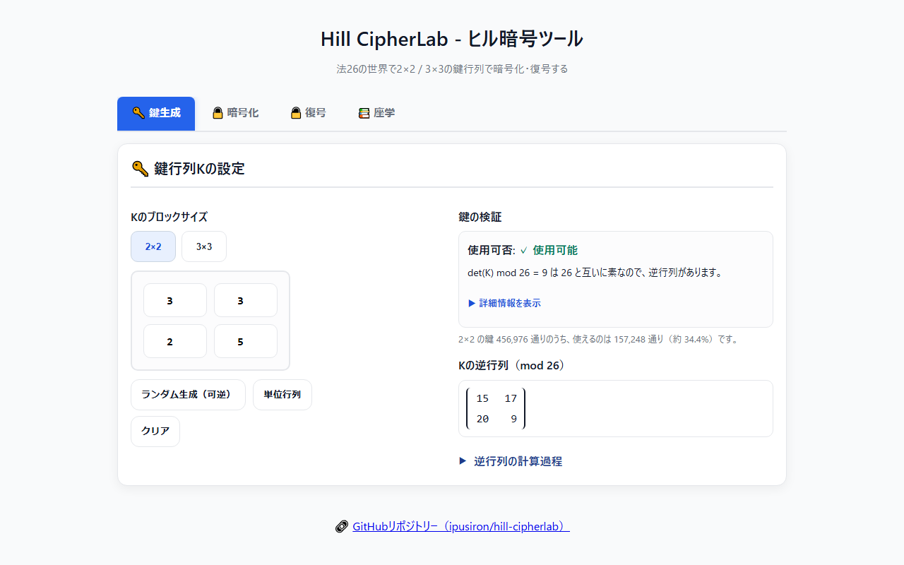
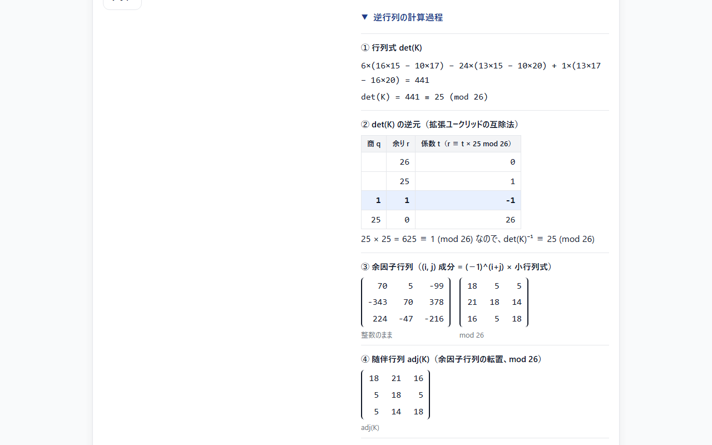
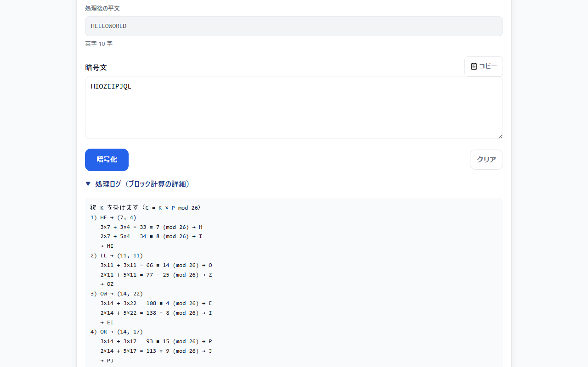

<!--
---
id: day093
slug: hill-cipherlab

title: "Hill CipherLab"

subtitle_ja: "ヒル暗号ツール"
subtitle_en: "Hill Cipher Educational Tool"

description_ja: "行列演算（2×2/3×3）を用いた古典暗号「ヒル暗号」の暗号化・復号ツール。mod 26での逆行列の計算過程（行列式・拡張ユークリッドの互除法・余因子・随伴）、鍵の可逆性検証、ブロックごとの計算ログを表示する。"
description_en: "Linear algebra–based classical cipher (Hill cipher) with 2×2 / 3×3 keys. Encrypt/Decrypt in mod 26, with the step-by-step matrix inverse (determinant, extended Euclid, cofactors, adjugate), key validation and per-block calculation logs."

category_ja:
  - 古典暗号
category_en:
  - Classical Cryptography

difficulty: 4

tags:
  - cryptography
  - classical
  - hill-cipher
  - matrix
  - linear-algebra
  - mod26
  - education
  - javascript

repo_url: "https://github.com/ipusiron/hill-cipherlab"
demo_url: "https://ipusiron.github.io/hill-cipherlab/"

hub: true
---
-->

# Hill CipherLab - ヒル暗号ツール


[](https://ipusiron.github.io/hill-cipherlab/)

**Day093 - 生成AIで作るセキュリティツール100**

**Hill CipherLab** は、「行列の掛け算と合同式」と暗号を結びつけた最初の暗号化である、ヒル暗号（Hill cipher）を体験できるツールです。

2×2または3×3の鍵行列を使い、法26（mod 26）での暗号化・復号を行います。
鍵の妥当性（`gcd(det(K), 26) = 1`）を判定し、逆行列を求める計算の途中（行列式・拡張ユークリッドの互除法・余因子・随伴・検算）をそのまま見せます。

> ここでいう法26の世界とは、「26を法とするモジュラー算術」を意味します。

---

## 🌐 デモページ

👉 [https://ipusiron.github.io/hill-cipherlab/](https://ipusiron.github.io/hill-cipherlab/)

ブラウザーで直接お試しいただけます。

---

## 📸 スクリーンショット

> 
> *鍵生成タブ：鍵の検証と逆行列（mod 26）*

> 
> *逆行列の計算過程（3×3の鍵GYBNQKURP）*

> 
> *暗号化タブ：処理ログに各ブロックの計算が出る*

---

## 👥 対象ユーザー

このツールは、以下のような方々を対象としています。

- 線形代数を学ぶ高校生・大学生
  - 行列式、逆行列、余因子行列などの抽象的な概念を、暗号化という具体的な応用で理解したい方
  - モジュラー算術（合同式）の実用例を体験したい方
- 情報セキュリティ・暗号学を学ぶ学生
  - 古典暗号から現代暗号への橋渡しとして、暗号の基礎概念を学びたい方
  - ブロック暗号の基本原理を理解したい方
  - 鍵の強度と数学的条件の関係を体感したい方
- 数学・情報科学の教員
  - 線形代数や暗号学の授業で使える実習教材を探している方
  - 学生に「数学が実社会でどう使われるか」を示したい方
- プログラミング学習者・開発者
  - ヒル暗号のアルゴリズムを自分で実装する際の検証ツールとして使いたい方
  - 暗号アルゴリズムの実装をデバッグしたい方
  - 教科書や課題の答え合わせをしたい方
- 暗号技術に興味がある一般の方
  - 歴史的な暗号システムがどのように機能するか知りたい方
  - ブラウザー上で手軽に暗号化・復号を試してみたい方
  - 数学と暗号の関係に興味がある方

---

## 📜 ヒル暗号の歴史的背景

- 1929年に数学者レスター・ヒル（Lester S. Hill）が考案。
  - 『アメリカン・マスマティカル・マンスリー』誌の6月/7月号に「代数アルファベットによる暗号」と題する論文を掲載した。
- 1931年、ヒルは『アメリカン・マスマティカル・マンスリー』誌に別の論文を発表した。
  - それは多数のマトリクスを用いた暗号化の方法であり、この数方陣にはそれ自身の加法と乗法の手順がある。
  - この特殊な多文字換字式暗号は文字対や反復文字、あるいは反復語など、解読の手がかりになりそうな要素を安全に秘匿できる。ただし、代数アルファベットと同様に、このマトリクスも万能ではなかった。
- 第二次世界大戦中、アメリカ合衆国は無線呼出符号（コールサイン）の文字群の暗号化にのみ、ヒル暗号を採用した。
  - 暗号化の手順が複雑であり、正当な受信者にとってすら復号に時間がかかりすぎたため、これ以外に実用化されなかった。

論文の書誌は次のとおりです。

- Lester S. Hill, "Cryptography in an Algebraic Alphabet", The American Mathematical Monthly, Vol. 36, No. 6, pp. 306–312, 1929（DOI: 10.1080/00029890.1929.11986963）
- Lester S. Hill, "Concerning Certain Linear Transformation Apparatus of Cryptography", The American Mathematical Monthly, Vol. 38, No. 3, pp. 135–154, 1931（DOI: 10.1080/00029890.1931.11987161）

---

## 🔢 ヒル暗号の基本的な仕組み

アルファベットA-Z（26文字）を0～25の数字とみなします。

`A=0, B=1, C=2, ..., Z=25`

### 鍵生成

暗号鍵に相当する鍵行列を決めます。

```math
K = \begin{bmatrix} 3 & 3 \\ 2 & 5 \end{bmatrix}
```

### 暗号化

例：2×2の鍵行列を使う場合

暗号化では、メッセージs文字のブロックを`s×s`の正方行列（一次変換）によって変換します。

平文m="HELP"とします。

1：文字を数字に変換します。

```math
\text{H}=7, \quad \text{E}=4, \quad \text{L}=11, \quad \text{P}=15
```

2：2文字ずつまとめてベクトルにします。

```math
\text{HE} \rightarrow \begin{bmatrix} 7 \\ 4 \end{bmatrix}, \quad
\text{LP} \rightarrow \begin{bmatrix} 11 \\ 15 \end{bmatrix}
```

3：鍵行列との掛け算をします。ただし、法26の世界で考えます。

最初の2文字"HE"は、次のように暗号化できます。

```math
K \begin{bmatrix} 7 \\ 4 \end{bmatrix} =
\begin{bmatrix} 3 & 3 \\ 2 & 5 \end{bmatrix} \begin{bmatrix} 7 \\ 4 \end{bmatrix} =
\begin{bmatrix} 3 \times 7 + 3 \times 4 \\ 2 \times 7 + 5 \times 4 \end{bmatrix} =
\begin{bmatrix} 21 + 12 \\ 14 + 20 \end{bmatrix} =
\begin{bmatrix} 33 \\ 34 \end{bmatrix} \equiv
\begin{bmatrix} 7 \\ 8 \end{bmatrix} \pmod{26}
```

$7 \rightarrow \text{H}$, $8 \rightarrow \text{I}$ なので、"HE"は"HI"に変換されます。

次の平文文字列"LP"は、次のように暗号化できます。

```math
K \begin{bmatrix} 11 \\ 15 \end{bmatrix} =
\begin{bmatrix} 3 & 3 \\ 2 & 5 \end{bmatrix} \begin{bmatrix} 11 \\ 15 \end{bmatrix} =
\begin{bmatrix} 3 \times 11 + 3 \times 15 \\ 2 \times 11 + 5 \times 15 \end{bmatrix} =
\begin{bmatrix} 33 + 45 \\ 22 + 75 \end{bmatrix} =
\begin{bmatrix} 78 \\ 97 \end{bmatrix} \equiv
\begin{bmatrix} 0 \\ 19 \end{bmatrix} \pmod{26}
```

$0 \rightarrow \text{A}$, $19 \rightarrow \text{T}$ なので、"LP"は"AT"に変換されます。

よって、暗号文c="HIAT"が得られました。

平文の英字の数がブロックの大きさ（ここでは2）で割り切れないときは、末尾に`X`を足してから暗号化します。足した`X`も暗号化されるので、暗号文の英字の数はいつもブロックの大きさの倍数になります。

### 復号

復号には鍵行列の逆行列を使います。

1：鍵行列 $K$ の逆行列 $K^{-1}$ をmod 26で求めます。

> **補足：2×2行列の逆行列の公式**
>
> 一般に、$`K = \begin{bmatrix} a & b \\ c & d \end{bmatrix}`$ の逆行列は次のように求められます。
>
> $`K^{-1} = \frac{1}{\det K} \begin{bmatrix} d & -b \\ -c & a \end{bmatrix} = \frac{1}{ad - bc} \begin{bmatrix} d & -b \\ -c & a \end{bmatrix}`$

この公式を踏まえて、計算しましょう。

```math
\det(K) = 3 \times 5 - 3 \times 2 = 15 - 6 = 9
```

9の逆数をmod 26で求めると、$`9^{-1} \equiv 3 \pmod{26}`$（$9 \times 3 = 27 \equiv 1$）

```math
K^{-1} = \frac{1}{\det K} \begin{bmatrix} 5 & -3 \\ -2 & 3 \end{bmatrix} =
3 \times \begin{bmatrix} 5 & -3 \\ -2 & 3 \end{bmatrix} \equiv
\begin{bmatrix} 15 & 17 \\ 20 & 9 \end{bmatrix} \pmod{26}
```

以下は検算です。

```math
K \cdot K^{-1} =
\begin{bmatrix} 3 & 3 \\ 2 & 5 \end{bmatrix} \begin{bmatrix} 15 & 17 \\ 20 & 9 \end{bmatrix} =
\begin{bmatrix} 3 \times 15 + 3 \times 20 & 3 \times 17 + 3 \times 9 \\
2 \times 15 + 5 \times 20 & 2 \times 17 + 5 \times 9 \end{bmatrix} =
\begin{bmatrix} 45 + 60 & 51 + 27 \\ 30 + 100 & 34 + 45 \end{bmatrix} =
\begin{bmatrix} 105 & 78 \\ 130 & 79 \end{bmatrix} \equiv
\begin{bmatrix} 1 & 0 \\ 0 & 1 \end{bmatrix} \pmod{26} = I
```

確かに得られた $K^{-1}$ と $K$ を乗算すると $I$（単位行列）になっています。

2：暗号文に逆行列を掛けます。

暗号文文字列"HI"は、次のように復号できます。

```math
K^{-1} \begin{bmatrix} 7 \\ 8 \end{bmatrix} =
\begin{bmatrix} 15 & 17 \\ 20 & 9 \end{bmatrix} \begin{bmatrix} 7 \\ 8 \end{bmatrix} =
\begin{bmatrix} 15 \times 7 + 17 \times 8 \\ 20 \times 7 + 9 \times 8 \end{bmatrix} =
\begin{bmatrix} 105 + 136 \\ 140 + 72 \end{bmatrix} =
\begin{bmatrix} 241 \\ 212 \end{bmatrix} \equiv
\begin{bmatrix} 7 \\ 4 \end{bmatrix} \pmod{26}
```

"HI"⇒"HE"と変換されます。

次に暗号文文字列"AT"は、次のように復号できます。

```math
K^{-1} \begin{bmatrix} 0 \\ 19 \end{bmatrix} =
\begin{bmatrix} 15 & 17 \\ 20 & 9 \end{bmatrix} \begin{bmatrix} 0 \\ 19 \end{bmatrix} =
\begin{bmatrix} 15 \times 0 + 17 \times 19 \\ 20 \times 0 + 9 \times 19 \end{bmatrix} =
\begin{bmatrix} 323 \\ 171 \end{bmatrix} \equiv
\begin{bmatrix} 11 \\ 15 \end{bmatrix} \pmod{26}
```

"AT"⇒"LP"と変換されます。

よって、復号結果として"HELP"が得られます。

---

## ⭐ ヒル暗号の特徴

### 長所

- 同じ文字でも、ブロックの中の位置と組む文字によって違う文字に暗号化される
- 単純な頻度分析では解読しにくい
- 行列のサイズを大きくすると、総当たりで試す鍵の数が増える

### 短所

- 平文と暗号文のペアが少しわかれば解読できてしまう（暗号化が線形なので、連立一次方程式として鍵が求まる）
- 現代の暗号としては弱い（コンピューターで簡単に解読可能）

---

## 🔗 別の古典暗号との関係性

### ヒル暗号は任意の多字を暗号化する

| 暗号名 | 暗号の種類 | 暗号化の特徴 | 自作ツール |
|---------------|------------|---------------------|------|
| シフト暗号 | 単一換字式暗号 | 1文字ずつ暗号化する。 | [Caesar Cipher Wheel Tool](https://ipusiron.github.io/caesar-cipher-wheel/) |
| ビジュネル暗号 | 多表式暗号 | 1文字ずつ暗号化する。 | [Vigenere Cipher Tool](https://ipusiron.github.io/vigenere-cipher-tool/) |
| ポルタ暗号      | 多文字換字式暗号 | 2文字を記号1文字に暗号化する。ただし、記号1文字を数字3桁に対応できる。 | [Porta CipherLab](https://ipusiron.github.io/porta-cipherlab/) |
| プレイフェア暗号 | 多文字換字式暗号 | 2文字を2文字に暗号化する。| [Playfair CipherLab](https://ipusiron.github.io/playfair-cipherlab/) |
| ヒル暗号 | 多文字換字式暗号 | s文字をまとめてs文字に暗号化する。 | 本ツール[Hill CipherLab](https://ipusiron.github.io/hill-cipherlab/) |

プレイフェア暗号やポルタ暗号のような、2文字を単位とする多文字換字式暗号の登場後、それを多字に拡張する試みがなかなか実を結んでいませんでした。
そんななか登場したのがヒル暗号です。

モジュラー算術自体が複雑というわけではありませんが、
当時はコンピューターのない時代であり、手作業で何度もモジュラー算術することは手間がかかりました。
そのため、このことがヒル暗号の実用化の壁となりました。

ヒルとルイス・ワイズナー（Louis Weisner）は、6文字ずつ処理する暗号化装置の特許（US 1,845,947、1932年登録）を取得しましたが、結局無線のコールサインの暗号化くらいにしか使われませんでした。
その一方で、暗号を数式で扱うという着眼点は多くの研究者に影響を与えました。

### ヒル暗号は行列版のアフィン暗号

以下のように、4文字の平文文字を一気に4文字の暗号文に変換するものとします（s=4）。

$$
\begin{aligned}
y_1 &= 24x_1 + 7x_2 + 18x_3 + 3x_4 \\
y_2 &= 4x_1 + 16x_2 + 5x_3 + 19x_4 \\
y_3 &= 17x_1 + 2x_2 + 6x_3 + 3x_4 \\
y_4 &= 20x_1 + 3x_2 + 6x_3 + 11x_4
\end{aligned}
$$

ベクトル $\mathbf{x}=(x_1, x_2, x_3, x_4)$ と $\mathbf{y}=(y_1, y_2, y_3, y_4)$ 、係数行列 $A$ を使うと、$`\mathbf{y}=A\mathbf{x}`$ と表現できます。

$\mathbf{y}=A\mathbf{x}+\mathbf{B}, \mathbf{B}=\mathbf{0}$ と考えると、アフィン暗号の行列版と捉えられます。
行列 $A$ が暗号鍵そのものです。

ただし、この $A$ は $\det A = -13204 \equiv 4 \pmod{26}$ で、2で割り切れるためmod 26の逆行列がありません。
このまま鍵に使うと、暗号文から平文に戻せません。
左上の24を25に変えると $\det A \equiv 21 \pmod{26}$ となり、鍵に使えます。
本ツールが扱うのは2×2と3×3なので、4×4の判定は手計算か別の方法で行います。

| 暗号名 | 暗号化の式 | 自作ツール |
|-------|------------|-----------|
| アフィン暗号 | $\text{Enc}(m)=(a \cdot m + b) \bmod n$ | [Affine CipherLab](https://ipusiron.github.io/affine-cipherlab/) |
| ヒル暗号 | $\text{Enc}(\mathbf{x})=A\mathbf{x}$ | [Hill CipherLab](https://ipusiron.github.io/hill-cipherlab/) |

---

## ✨ 本ツールでできること

本ツールは4つのタブで構成されています。

### 🔑 鍵生成タブ

- 2×2 / 3×3の鍵行列を設定する：サイズの切り替え、手動入力、ランダム生成、単位行列、クリア
- 鍵のマスは整数だけを受け付ける：空欄・小数・指数表記・範囲外（−999〜999）は、何行何列が誤りかを示して判定を止める
- 鍵を検証する：使用可否と、使えない理由（det(K)が偶数か、13の倍数か）を文で示す
  - 詳細情報：`det(K)`（入力した整数のまま）、`det(K) mod 26`、`gcd(det(K), 26)`、`det(K)⁻¹ mod 26`
- 可逆な鍵の割合を示す：2×2は456,976通りのうち157,248通り（約34.4%）、3×3は約30.1%
- 逆行列（mod 26）と、その計算過程を表示する
  - ① 行列式 ② det(K)の逆元（拡張ユークリッドの互除法の表）③ 余因子行列 ④ 随伴行列 ⑤ det(K)⁻¹ 倍してmod 26 ⑥ 検算K × K⁻¹ ≡ I
- ランダム生成は `crypto.getRandomValues` で成分を選び、可逆になるまで引き直す
- 矢印キーで行列のマスの間を移動できる

### 🔒 暗号化タブ

- 平文を入れると、その場で暗号文が出る（鍵を変えても計算し直す）
- 英字だけを使う：小文字は大文字に、全角英字（ＡＢＣ）は半角にそろえ、空白・記号・かなは無視する
- 処理後の平文：末尾に足した`X`を含め、実際に暗号化される文字列と、英字の数・足した`X`の数・使わなかった文字の数を示す
- 処理ログ：ブロックごとに、鍵の各行との積和・mod 26・文字を1行ずつ示す（例：`3×7 + 3×4 = 33 ≡ 7 (mod 26) → H`）
- 暗号文をクリップボードにコピーできる

### 🔓 復号タブ

- 暗号文を入れると、その場で平文が出る。暗号化タブから暗号文を同期できる
- 英字の数がブロックの大きさの倍数でない暗号文は、`X`を足して復号せずに止める
  - 入力中は「あと何字で区切りが合うか」を控えめに示し、復号ボタンを押したときは警告を出す
- 処理ログ：逆行列K⁻¹ を掛ける計算を、暗号化と同じ形で示す
- 平文をクリップボードにコピーできる

### 📚 座学タブ

- 鍵の可逆性条件：`gcd(det(K), 26) = 1` の意味と重要性
- 本ツールの制約：非英字の扱い、パディングの`X`についての説明
- 教育的意義：線形代数、暗号の基礎、セキュリティの限界について

### 数式（英大文字アルファベット）

- 平文ベクトル $P \in \mathbb{Z}_{26}^n$（n=2 or 3）
- 鍵行列 $K \in \mathbb{Z}_{26}^{n\times n}$
- 暗号化 $C \equiv K P \pmod{26}$
- 復号 $P \equiv K^{-1} C \pmod{26}$
- ただし、逆行列が存在する条件は $\gcd(\det K, 26)=1$（= 2と13の倍数でない）

### 注意点

- 入力は英字のみ扱います（数字・記号・空白は無視）。文字は `A=0,…,Z=25` に対応させ、ブロック長に満たない末尾は `X` で自動パディングします。
- 非英字・空白・記号は暗号化時に無視されるため、復号結果には単語間の空白や文末のピリオドなどは含まれません。復号後は文脈から適切に補う必要があります。
  - 例: `"HELLO WORLD."` → 暗号化前処理 → `"HELLOWORLD"` → 暗号化 → 復号 → `"HELLOWORLD"` （空白とピリオドは復元されない）
- 復号結果の末尾にXが現れた場合、パディング用のXである可能性が高いですが、元のメッセージに含まれていた文字Xである可能性もあります。文脈から判断する必要があります。
- 26は合成数（2×13）なので、det(K)が偶数または13の倍数だと逆行列が存在しません。
- 3×3は2×2より、逆行列が存在しない鍵の割合がやや高くなります（使える鍵は約34.4%から約30.1%へ）。
- 英字は10,000字まで扱えます（3×3で10,000字なら、パディング後は10,002字）。

---

## 🎯 ユースケース

### このツールならではの使い方

- 合同式の逆元の表を作る：鍵を[[7,0],[0,1]]にするとdet(K) = 7になり、「逆行列の計算過程」の②に、7の逆元を求める拡張ユークリッドの互除法の表が出ます（7 × 15 = 105 ≡ 1なので7⁻¹ ≡ 15）。数論の授業で、どの数の逆元表も同じ手で作れ、偶数や13のように逆元のない数では、余りが1にならずに表が止まる様子を見せられます。
- 実数の逆行列の答え合わせに使う：③の「整数のまま」の余因子行列はmod 26をとる前の値です。転置してdet(K)で割れば、ふつうの（実数の）逆行列になります。K = [[3,3],[2,5]]ならadj(K) = [[5,−3],[−2,3]]、det(K) = 9なので、K⁻¹ = (1/9)·[[5,−3],[−2,3]]です。線形代数の宿題の検算に使えます。
- 中国剰余定理で鍵を数える：2×2で使える鍵157,248通りは、mod 2で可逆な行列6通りと、mod 13で可逆な行列26,208通りの積です（6 × 26,208 = 157,248）。「26 = 2 × 13なので、2と13のそれぞれで逆行列があればよい」ことを、画面の割合（約34.4%）と照らして確かめられます。
- 同じ文字が同じ暗号文字にならないことを見せる：Hello worldのLは、LLの組ではOとZに、LDの組ではQに変わります（暗号文HIOZEIPJQL）。1文字ずつの頻度分析が通用しにくい理由を、処理ログの行で示せます。
- 謎解き・脱出ゲームの出題と解説に使う：出題者が鍵と答えの単語を決めて暗号文を作り、処理ログをそのまま解説に貼れます。HELP → HIATなら、2ブロックの計算が4行で出ます。

### シナリオ1: 線形代数の授業での実習教材として

対象: 高校・大学の数学教育

線形代数を学ぶ学生にとって、抽象的な行列演算を「暗号化」という具体的な応用で体験できます。

- 学習の流れ
  1. 「鍵生成」タブで2×2の鍵行列を手動入力（例: $`K = \begin{bmatrix} 3 & 3 \\ 2 & 5 \end{bmatrix}`$）
  2. 行列式が自動計算され、 $gcd(det, 26) = 1$ の条件を確認
  3. 「逆行列の計算過程」を開き、余因子→随伴→detの逆元の順に逆行列が求まる過程を観察
  4. 「暗号化」タブで `"HELP"` を暗号化 → `"HIAT"` を確認
  5. 「復号」タブで `"HIAT"` を復号 → 元の `"HELP"` に戻ることを確認
- 教育効果
  - 行列式、余因子、随伴行列の計算が「なぜ必要か」を実感
  - モジュラー算術（合同式）の実用例を体験
  - 「逆行列が存在しない場合」の影響を直接確認できる

### シナリオ2: 暗号学入門の演習として

対象: 情報セキュリティを学ぶ学生・エンジニア

古典暗号から現代暗号への橋渡しとして、暗号の基礎概念を学べます。

- 学習の流れ
  1. まず2×2行列で暗号化・復号の基本を理解
  2. 3×3行列に変更し、ブロックサイズが大きくなると何が変わるかを観察
  3. 「ランダム生成」で複数の鍵を試し、可逆な鍵の割合（約34.4%・約30.1%）と照らす
  4. 意図的に `det(K) = 13` の行列（例: [[13,0],[0,1]]）を作成し、使えない理由の表示を確認
  5. 処理ログで暗号化の内部動作（ブロック分割→行列演算）を確認
- 教育効果
  - 「鍵の強度」が数学的条件に依存することを理解
  - ブロック暗号の基本概念（平文をブロックに分割して処理）を体験
  - 既知平文攻撃の脆弱性（平文と暗号文の組がいくつかわかると鍵が求まる）を学ぶ入口

### シナリオ3: プログラミング課題の検証ツールとして

対象: 暗号アルゴリズムを実装する開発者・学生

自分で実装したヒル暗号のプログラムの動作確認に利用できます。

- 活用方法
  1. 自作プログラムと同じ鍵行列をツールに入力
  2. 同じ平文を入力し、暗号化結果を比較
  3. 処理ログで中間値（ブロックごとの積和とmod 26）を確認
  4. 復号処理も同様に検証し、デバッグに活用
- 具体例
  ```python
  # Pythonで実装したヒル暗号の検証（3×3の鍵。キーワード GYBNQKURP を A=0 で数にしたもの）
  K = [[6, 24, 1], [13, 16, 10], [20, 17, 15]]
  plaintext = "ACT"

  # ツールで同じ鍵・平文を入力
  # → 暗号文 "POH" が得られる
  # → 自作プログラムの出力と一致するか確認
  ```
- メリット
  - 逆行列計算のバグを発見しやすい（逆行列は[[8,5,10],[21,8,21],[21,12,8]]）
  - パディング処理の実装ミスを検出できる
  - 教科書の例題の答え合わせにも使える

### そのほかの使い方

- 教育（数学）：連立一次方程式をmod 26で解く練習の題材にする。鍵を変えるたびに逆行列が変わるので、問題を何題でも作れる
- 教育（情報）：「暗号文の長さがブロックの倍数でないと復号できない」ことから、パディングという考え方を説明する
- 仕事（プログラマー以外も）：表計算ソフトの `MMULT`・`MOD` で同じ計算を組むときの検算に使う
- 暮らし・趣味：家族や友人との交換日記・寄せ書きに、鍵を決めた暗号のメッセージを入れて遊ぶ（ヒル暗号は解読されうるので、秘密を守る用途には使わない）
- 研究・調べもの：歴史の本に出てくるヒル暗号の例を、行列と数の対応から検算する
- ほかのツールと組み合わせる
  - [Affine CipherLab](https://ipusiron.github.io/affine-cipherlab/)（Day049）：1文字ずつのアフィン暗号と並べ、「行列版のアフィン暗号」の意味を比べる
  - [Playfair CipherLab](https://ipusiron.github.io/playfair-cipherlab/)（Day027）：同じ2文字ずつの暗号で、表を使う方式と行列を使う方式を比べる
  - [Frequency Analyzer](https://ipusiron.github.io/frequency-analyzer/)（Day009）：ヒル暗号の暗号文の文字の頻度が、単一換字式より平らになることを確かめる
  - [Cipher Clairvoyance](https://ipusiron.github.io/cipher-clairvoyance/)（Day044）：暗号文から方式を推定し、ヒル暗号（2×2）なら鍵の行列まで推し量る

---

## 🎓 教育的ポイント

- 線形代数（行列式・余因子・随伴・逆行列）を有限環 $\mathbb{Z}_{26}$ 上で体験
- 「鍵の強度」と「逆行列の存在条件」の直感を養成
- ブロック置換型の古典暗号の限界（既知平文攻撃など）へ橋渡し

---

## 📐 実装に使う定義と数式

### 余因子行列（Cofactor Matrix）

各要素の余因子を並べた行列です。余因子とは、その要素を除いた小行列の行列式に符号 $(-1)^{i+j}$ を掛けたものです。

```math
\mathrm{Cof}(K) = [(-1)^{i+j}\det M_{ij}]
```

ここで $M_{ij}$ は、 $i$ 行 $j$ 列を除いた小行列（minor）を指します。

例：$`K = \begin{bmatrix} 3 & 3 \\ 2 & 5 \end{bmatrix}`$ の場合

- $(1,1)$ 要素の余因子: $(-1)^{1+1} \det[5] = 5$
- $(1,2)$ 要素の余因子: $(-1)^{1+2} \det[2] = -2$
- $(2,1)$ 要素の余因子: $(-1)^{2+1} \det[3] = -3$
- $(2,2)$ 要素の余因子: $(-1)^{2+2} \det[3] = 3$

よって、$`\mathrm{Cof}(K) = \begin{bmatrix} 5 & -2 \\ -3 & 3 \end{bmatrix}`$

### 随伴行列（Adjugate Matrix / Adjoint）

余因子行列の転置（行と列を入れ替えたもの）が随伴行列です。

```math
\mathrm{adj}(K) = \mathrm{Cof}(K)^\mathsf{T}
```

例：上記の余因子行列を転置すると

```math
\mathrm{adj}(K) = \begin{bmatrix} 5 & -3 \\ -2 & 3 \end{bmatrix}
```

### 逆行列の計算式

随伴行列と行列式の逆元を使って、逆行列を計算します。

```math
K^{-1} \equiv (\det K)^{-1} \cdot \mathrm{adj}(K) \pmod{26}
```

この公式により、mod 26の世界でも逆行列を求めることができます。

---

## 🔒 セキュリティ

- 外部への通信はしません。入力した平文・暗号文・鍵は、ブラウザーの中だけで計算します
- Content Security Policy（`<meta>`）で、読み込めるものを同じオリジンのスクリプト・スタイルシートに限っています（インラインのスクリプトとスタイル、外部のホストは許可しない）。リファラーは送りません
- 入力は `textContent` と `textarea.value` だけで画面に出し、`innerHTML` は使いません
- 入力の上限：英字10,000字、入力欄100,000文字、鍵のマスは −999〜999の整数
- ランダム生成は `crypto.getRandomValues` を使います。ただし、ヒル暗号そのものが既知平文攻撃に弱いので、作った鍵でも秘密を守る用途には使えません

---

## 🧪 テスト

```bash
npm test
```

- Node.js 22以上の `node --test` で動きます。依存パッケージはありません
- GitHub Actionsで、pushとpull_requestのたびに実行します
- 計算部（`js/hill-core.js`）の既知解答（HELP → HIAT、ACT → POH）、往復、2×2の全456,976通りの可逆判定、境界（英字10,000字・長さ不足の暗号文・鍵のマス）を検証します
- READMEの例と数値（逆行列、途中の積和、可逆な鍵の数と割合、4×4の行列式、ユースケースの数値）は、テストが計算部で計算し直して確かめます
- index.htmlのCSP・ARIA、配色のコントラスト（4.5:1以上）、行の長さ、辞書のキーも検証します

---

## 🔧 技術実装詳細

アルゴリズム、セキュリティ対策、テストなどの技術的な詳細については、開発者向けドキュメントを参照してください。

👉 [TECHNICAL.md -技術実装詳細](TECHNICAL.md)

主な内容は次のとおりです。

- モジュラー演算と拡張ユークリッドの互除法
- 2×2 / 3×3 行列の逆行列計算アルゴリズム
- 入力の検証と、結果をその場で計算し直す仕組み
- CSP・XSS対策などのセキュリティ実装
- アーキテクチャ設計とデータフロー

---

## 📁 ディレクトリー構造

```
hill-cipherlab/
├── .github/                  # GitHub の設定
│   └── workflows/            # GitHub Actions のワークフロー
│       └── test.yml          # push と pull_request で npm test を実行する
├── assets/                   # README の画像
│   ├── screenshot.png        # 鍵生成タブ（鍵の検証と逆行列）
│   ├── screenshot2.png       # 逆行列の計算過程（3×3）
│   └── screenshot3.png       # 暗号化タブと処理ログ
├── js/                       # 画面と共有する通常のスクリプト（file:// でも動く）
│   ├── hill-core.js          # 計算部（行列式・逆行列・暗号化・復号。DOM に依存しない）
│   └── messages.js           # 画面に出す文言の辞書
├── test/                     # node --test のテスト
│   ├── contrast.test.js      # 配色のコントラスト（4.5:1以上）
│   ├── core.test.js          # 計算部の既知解答・往復・全数・境界
│   ├── format.test.js        # 行の長さ・行数・改行コード
│   ├── html.test.js          # index.html の CSP・ARIA・id
│   ├── load.js               # 通常のスクリプトをテストに読み込む道具
│   ├── messages.test.js      # 辞書のキーと、画面の処理に日本語を置かないこと
│   └── readme.test.js        # README の例・数値・構造の検証
├── .gitignore                # Git の除外設定
├── .nojekyll                 # GitHub Pages で Jekyll を使わない
├── CLAUDE.md                 # Claude Code 向けのプロジェクト情報
├── LICENSE                   # MIT ライセンス
├── README.md                 # このファイル
├── TECHNICAL.md              # 技術実装詳細（開発者向け）
├── index.html                # 画面（4タブ構成）
├── package.json              # npm test の定義（依存なし）
├── script.js                 # 画面の処理（DOM の読み書き）
└── style.css                 # スタイルシート（Calm Light Theme）
```

---

## 💻 動作環境

- Chrome・Edge・Firefox・Safariの最新版
- ビルドは不要です。`index.html` を直接開く（file://）方法と、HTTPで配信する方法のどちらでも動きます

```bash
python -m http.server 8000
# ブラウザーで http://localhost:8000 を開く
```

---

## 📄 ライセンス

MIT License – 詳細は [LICENSE](LICENSE) を参照してください。

---

## 🛠️ このツールについて

本ツールは、「生成AIで作るセキュリティツール100」プロジェクトの一環として開発されました。
このプロジェクトでは、AIの支援を活用しながら、セキュリティに関連するさまざまなツールを100日間にわたり制作・公開していく取り組みを行っています。

プロジェクトの詳細や他のツールについては、以下のページをご覧ください。

🔗 [https://akademeia.info/?page_id=42163](https://akademeia.info/?page_id=42163)
